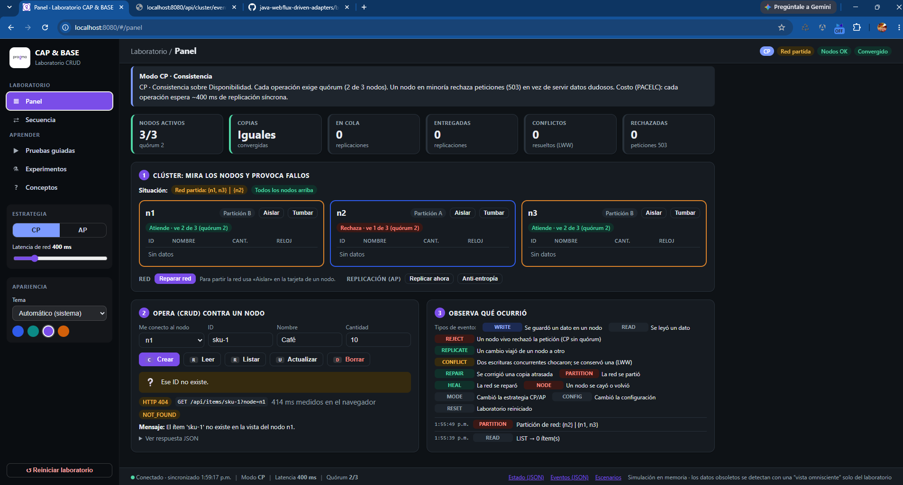
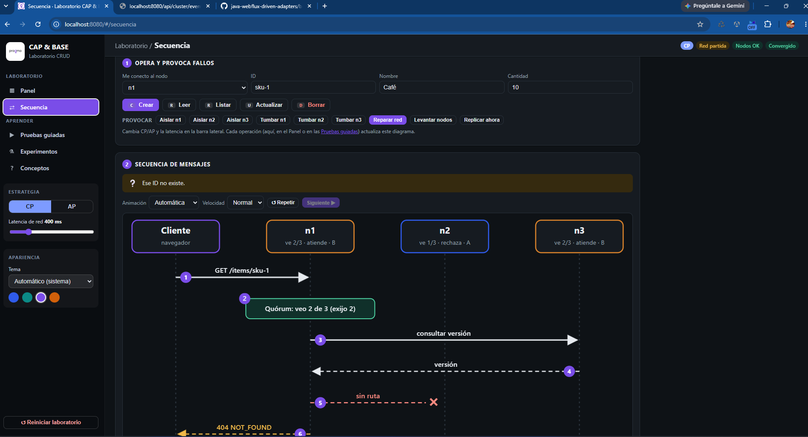

# Laboratorio CRUD - CAP & BASE 

Un CRUD de ítems de inventario sobre un **clúster simulado de 3 nodos** (`n1`, `n2`, `n3`) que puede
operar en dos modos intercambiables en caliente y sufrir **particiones de red** y **caídas de nodos**:

| Modo | Filosofía | Qué hace ante una partición |
|------|-----------|-----------------------------|
| **CP** | Consistencia + Tolerancia a particiones | Exige **quórum** (2 de 3). El lado minoritario **rechaza** peticiones con `503`. |
| **AP** | Disponibilidad + Tolerancia a particiones (**BASE**) | Todo nodo vivo responde con su **copia local** y replica de forma asíncrona. Hay lecturas obsoletas y conflictos que se resuelven al converger. |

Stack: Java 21 · Spring Boot 3.5 WebFlux · Gradle (Groovy DSL). Sin base de datos: cada nodo guarda su propio almacén en memoria,
para que la divergencia entre réplicas sea real y observable.

## Ejecutar

```bash
gradle wrapper --gradle-version 8.14.3   # una sola vez (el wrapper no se incluye)
./gradlew bootRun                        # o: gradle bootRun
# abrir http://localhost:8080
./gradlew test                           # pruebas unitarias + integración
```

Configuración (`application.yml`): `lab.latency-ms` (latencia de red simulada, por defecto 400 ms) y
`lab.replication.auto` (`false` = la replicación solo avanza a mano; lo usan las pruebas de integración).

## Frontend Dashboard



## Secuencias Visuales de flujos




## Qué se ve en el panel (`/`)

- **Selector CP / AP** y **slider de latencia** de red simulada.
- **Tres tarjetas de nodo** con su almacén local, sus relojes vectoriales, si están caídos, a qué lado de la partición pertenecen y si **pueden atender** (en CP: `quórum x/3`).
  Las filas en ámbar son claves en las que las réplicas **divergen**.
- **Controles de red**: aislar un nodo, tumbarlo/levantarlo, reparar la red, *replicar ahora* y *anti-entropía*.
- **Consola CRUD**: eliges a qué nodo te conectas y ves, por cada operación, qué nodos participaron, el quórum exigido, si el dato devuelto es **obsoleto** y la latencia.
- **Registro de eventos**: escrituras, rechazos, replicaciones, conflictos, reparaciones.
- **Experimentos guiados**: transcripciones paso a paso (corren sobre un clúster aparte; no tocan el estado del panel).

## Experimentos para demostrar CAP y BASE

### 1. CP sacrifica la disponibilidad (la "A" de CAP)
1. Modo **CP** → crea `sku-1` (qty 10) desde `n1`: se confirma con **3/3** nodos.
2. **Aislar n1** (partición `{n1} | {n2,n3}`).
3. Lee o actualiza `sku-1` conectado a `n1` → **503 `CP_QUORUM_UNAVAILABLE`**: está vivo, pero sin mayoría prefiere fallar.
4. Actualiza `sku-1` (qty 20) desde `n2` → funciona (2/3). Lee desde `n3` → 20, `stale=false`.
5. **Reparar red** → `n1` se pone al día (anti-entropía) y vuelve a servir el valor correcto. *Nunca se sirvió un dato incoherente.*

### 2. AP / BASE: disponible, blando, eventualmente consistente
1. Modo **AP**, latencia 2000 ms. Crea `sku-1` en `n1`; lee desde `n3` inmediatamente → `404` con la pista *"la replicación aún no llegó"* (**estado blando / lectura obsoleta**). Tras unos segundos (o *Replicar ahora*), `n3` ya lo tiene (**consistencia eventual**).
2. **Aislar n1**. Actualiza `sku-1` a 99 desde `n1` y a 20 desde `n2`: **ambas escrituras se aceptan** (*Basically Available*).
3. *Replicar ahora*: `n1=99`, `n2=n3=20`, replicaciones **bloqueadas** por la partición (*hinted handoff*), réplicas **divergentes**. Leer en `n1` devuelve `Dato obsoleto ⚠`.
4. **Reparar red** → *Replicar ahora*: los relojes vectoriales detectan que fueron escrituras **concurrentes**; **Last-Write-Wins** conserva `20` en todas las réplicas y el evento `CONFLICT` explica cuál se descartó. Las réplicas **convergen** (y se perdió la actualización a 99: el precio de AP).

### 3. Quórum ante caídas de nodos (CP)
Tumba `n3` → todo funciona (2/3). Tumba también `n2` → `n1` rechaza (1/3). Levanta `n2` → se recupera. Levanta `n3` → se actualiza solo.

### 4. PACELC: el costo "Else" (latencia vs. consistencia)
Con el slider en 800 ms, compara la latencia mostrada en cada operación: en **CP** cada lectura/escritura espera la replicación o consulta de quórum (~800 ms);
en **AP** responde en ~0 ms y la replicación viaja en segundo plano. Aun **sin partición** hay un trade-off.

## Dónde vive cada concepto en el código

| Concepto | Dónde |
|----------|-------|
| Partición de red, caída de nodos, alcanzabilidad | `ClusterService#partition`, `nodeDown`, `canTalk`, `reachableFrom` |
| **CP**: quórum, escritura síncrona, lectura por quórum, *read-repair* | `ClusterService#write` / `read` / `requireQuorum` / `readRepair` (rama `Mode.CP`) |
| **AP**: respuesta local, replicación asíncrona en cola | `ClusterService#write` / `read` (rama `Mode.AP`), `deliverDue`, `ReplicationScheduler` |
| **Soft state**: réplicas distintas + detección de datos obsoletos | `ClusterService#oracle`, `isStale`, `snapshot().convergence` |
| **Eventual consistency**: unión determinista de versiones | `VersionedRecord#merge` (semirretículo) |
| Detección de conflictos | `VectorClock#compare` → `Ordering.CONCURRENT` |
| Resolución de conflictos (LWW) | `VersionedRecord#merge` (gana `(timestamp, origen)` mayor) |
| Borrados replicables | *Tombstones* (`VersionedRecord.tombstone`) |
| *Hinted handoff* | Cola `ReplicationMessage` que espera a que el destino sea alcanzable |
| Anti-entropía | `ClusterService#antiEntropy` |
| Costo PACELC | `ItemService#timed` (retardo reactivo solo en CP) |

### Por qué converge siempre
`VersionedRecord.merge` es **conmutativo, asociativo e idempotente** (los datos se eligen por `(timestamp, origen)` y los relojes por máximo componente a componente).
Por eso el orden en que lleguen los mensajes de replicación da igual: todas las réplicas terminan en el mismo estado. Está verificado en `VersionedRecordTest`
y `ApModeTest#convergenceDoesNotDependOnDeliveryOrder`.

## API

`node` (query, por defecto `n1`) indica a qué nodo "se conecta el cliente". Toda respuesta de CRUD es `{ "data": …, "meta": { servedBy, mode, nodesContacted, required, contactedNodes, stale, note, latencyMs } }`.

| Método | Ruta | Descripción |
|--------|------|-------------|
| `POST` | `/api/items?node=n1` | Crear `{id?, name, quantity}` → 201 (409 si ya existe en la vista del nodo) |
| `GET` | `/api/items/{id}?node=` · `/api/items?node=` | Leer / listar |
| `PUT` | `/api/items/{id}?node=` | Actualizar `{name, quantity}` |
| `DELETE` | `/api/items/{id}?node=` | Borrar (replica una lápida) |
| `GET` | `/api/cluster/state` · `/api/cluster/events?limit=` | Estado completo / eventos |
| `POST` | `/api/cluster/mode` `{"mode":"CP"\|"AP"}` | Cambiar estrategia |
| `POST` | `/api/cluster/latency` `{"ms":400}` | Latencia simulada (0–10000) |
| `POST` | `/api/cluster/partition` `{"groups":[["n1"],["n2","n3"]]}` | Particionar la red |
| `POST` | `/api/cluster/heal` | Reparar la red (en CP además ejecuta anti-entropía) |
| `POST` | `/api/cluster/nodes/{id}/down` · `/up` | Tumbar / levantar un nodo |
| `POST` | `/api/cluster/replicate-now` · `/anti-entropy` · `/reset` | Forzar replicación / reparar / reiniciar |
| `GET` | `/api/lab/scenarios` · `/api/lab/scenarios/{id}` | Experimentos guiados (`cp-partition`, `ap-partition`, `cp-node-failures`) |

Errores: `{ code, message, status, mode, details }` — p. ej. `503 CP_QUORUM_UNAVAILABLE`, `503 NODE_DOWN`, `404 NOT_FOUND`, `409 ALREADY_EXISTS`, `400 VALIDATION_ERROR`.

```bash
H='Content-Type: application/json'
curl -s -XPOST localhost:8080/api/cluster/mode -H "$H" -d '{"mode":"CP"}' >/dev/null
curl -s -XPOST 'localhost:8080/api/items?node=n1' -H "$H" -d '{"id":"sku-1","name":"Café","quantity":10}'
curl -s -XPOST localhost:8080/api/cluster/partition -H "$H" -d '{"groups":[["n1"],["n2","n3"]]}' >/dev/null
curl -si 'localhost:8080/api/items/sku-1?node=n1' | head -1   # HTTP/1.1 503  (minoría)
curl -si 'localhost:8080/api/items/sku-1?node=n2' | head -1   # HTTP/1.1 200  (mayoría)
```

## Pruebas

| Clase | Qué demuestra |
|-------|---------------|
| `CpModeTest` | Replicación síncrona, minoría rechaza (503), mayoría nunca sirve datos obsoletos, catch-up al sanar, tolerancia a 1 de 3 caídas, reglas del CRUD |
| `ApModeTest` | Disponibilidad en ambos lados, lecturas obsoletas → consistencia eventual, divergencia y convergencia por LWW (1 conflicto), independencia del orden de entrega, tombstones, *hinted handoff*, anti-entropía |
| `VersionedRecordTest` | Relojes vectoriales y propiedades algebraicas del `merge` |
| `ScenarioRunnerTest` | Que los experimentos guiados reflejan el comportamiento real |
| `ApiIntegrationTest` | HTTP end-to-end (WebTestClient): CP vs AP, 503 con detalles, validaciones, escenarios |

## Resumen

- **CAP no es "elige 2 de 3"**: las particiones *ocurren*; la decisión real es qué hacer **durante** una partición (C o A). Sin partición puedes tener ambas.
- **La C de CAP** es *linealizabilidad* (todos ven el último valor confirmado), **no** la C de ACID (integridad de restricciones).
- **La A de CAP** exige que *todo nodo no caído* responda, y con respuesta no-error; por eso un nodo CP en minoría cuenta como "no disponible" aunque esté vivo.
- **PACELC** completa el cuadro: *si hay Partición → A o C; Else → Latencia o Consistencia*. CP paga latencia siempre; AP la evita a costa de lecturas obsoletas.
- **BASE vs ACID**: *Basically Available, Soft state, Eventual consistency* frente a *Atomicity, Consistency, Isolation, Durability*; BASE no es "sin consistencia", es consistencia **diferida** con un mecanismo explícito de convergencia.
- **Elegir según el dominio**: saldos, inventario crítico, locks, coordinación → **CP**. Carrito, catálogo, feeds, contadores, sesiones → **AP**. Muchos sistemas mezclan ambos por operación.

## Límites y extensiones posibles

- Es una **simulación en proceso**: nodos y red son lógicos (sin sockets). A cambio, el comportamiento es determinista y probable.
- LWW pierde escrituras concurrentes. Extensiones naturales: **CRDTs** (p. ej. contador de stock), *siblings* estilo Dynamo/Riak para que decida la aplicación, o **consistencia ajustable** por petición (`R`/`W` como en Cassandra).
- Para llevarlo a infraestructura real: un proceso por nodo (puertos distintos) y *toxiproxy*/`tc` para inyectar particiones.
